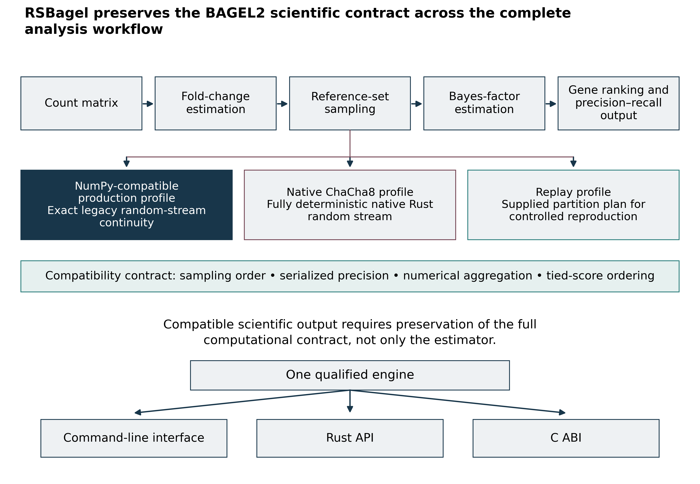
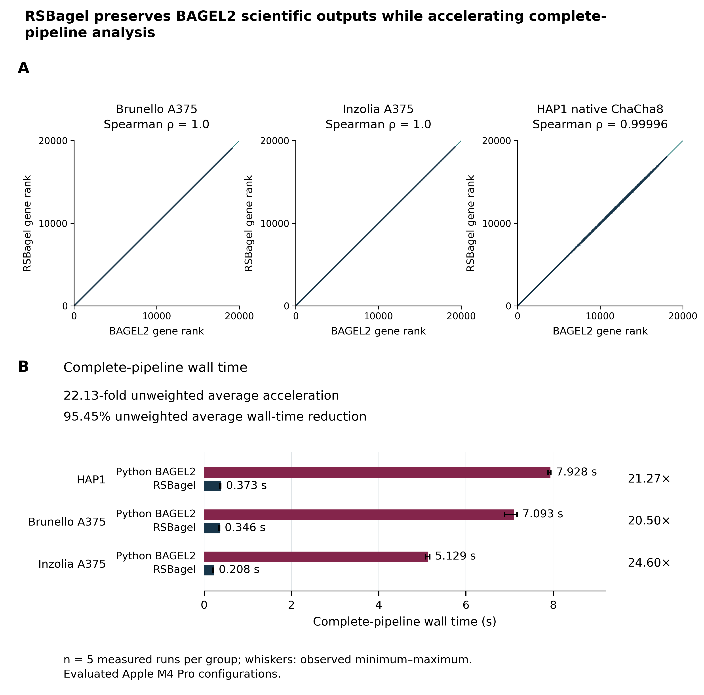

# RSBagel

Rust implementation of the BAGEL2 scientific workflow for Bayesian analysis of pooled CRISPR fitness screens.

**RSBagel v1.0.0 is source-only software for Apple Silicon macOS.**

Build RSBagel locally from source. No binary distribution is provided.

## Documentation

- [Quick Start](docs/RSBagel-Quick-Start.md): build and run the beginner example.
- [User Manual](docs/RSBagel-User-Manual.md): prepare inputs, run an analysis, and interpret results.
- [Manuscript](docs/RSBagel-Manuscript.pdf): methods, comparisons, and limitations.
- [Beginner example](examples/beginner/README.md): synthetic teaching data and expected outputs.

For software integration, see the [Developer Integration Guide](developer/RSBagel-Developer-Integration-Guide.md). The [third-party notices](third-party-licenses/) are also included.

## What RSBagel does

- Calculates normalized fold changes from guide-count matrices.
- Estimates gene Bayes factors using essential and nonessential reference sets.
- Produces gene rankings and precision-recall summaries.
- Supports individual-guide and single-target array observations.
- Provides a command-line interface, Rust API, and C ABI.

Individual sgRNAs are separate observations in a Brunello-style screen. A four-guide single-target Inzolia-style array is one observation and must not be divided into four artificial observations.

## How RSBagel works

`fc` normalizes counts and calculates fold changes. `bf` uses reference sets to estimate gene Bayes factors. `pr` evaluates ranked genes against essential and nonessential reference sets.

<p align="center"></p>

*Figure 1. RSBagel preserves the BAGEL2 scientific contract across fold-change estimation, reference-set sampling, Bayes-factor estimation, gene ranking, and precision-recall analysis. One qualified engine supports the command-line interface, Rust API, and C ABI.*

The compatibility contract includes sampling order, serialized precision, numerical aggregation, and tied-score ordering.

## Validation and performance

RSBagel achieved exact observable gene-rank agreement with BAGEL2 for the Brunello and Inzolia A375 analyses. The native ChaCha8 HAP1 analysis produced a nearly identical global ranking. Across the three evaluated workloads, RSBagel achieved an unweighted average acceleration of 22.13-fold and an unweighted average wall-time reduction of 95.45%.

<p align="center"></p>

*Figure 2. Gene-rank agreement with BAGEL2 and complete-pipeline wall time on the evaluated Apple M4 Pro configurations. Brunello and Inzolia used the NumPy-compatible profile. HAP1 used native ChaCha8.*

These results apply to the evaluated Apple M4 Pro configurations and workloads. They do not establish universal speedup, universal memory reduction, or universal internal bitwise identity. See the [manuscript](docs/RSBagel-Manuscript.pdf) for the complete methods and limitations.

## Requirements and installation

Use an Apple Silicon Mac with Git, Rust and Cargo, and Apple command-line developer tools. Clone the public repository:

```sh
git clone https://github.com/Yoonecorn/RSBagel.git
```

Enter the checkout:

```sh
cd RSBagel
```

Use the default local Cargo output directory so the path below matches the build:

```sh
unset CARGO_TARGET_DIR
```

Build the release executable for the supported target:

```sh
cargo build --release --locked --target aarch64-apple-darwin
```

Check the executable's help:

```sh
target/aarch64-apple-darwin/release/rsbagel --help
```

## Quick Start

Follow the [Quick Start](docs/RSBagel-Quick-Start.md) to prepare and run the [beginner example](examples/beginner/README.md).

## Inputs and outputs

Routine inputs are a count matrix, an essential-gene list, and a nonessential-gene list. The main outputs are `results.foldchange`, `results.normed_readcount`, `results.bf`, and `results.pr`. See the [User Manual](docs/RSBagel-User-Manual.md) for field definitions and interpretation.

## Sampling profiles

NumPy-compatible mode is the default compatibility profile. Native ChaCha8 is deterministic and experimental. Replay mode uses a supplied partition plan for controlled reproduction. Equal numerical seeds do not imply identical random streams under different generators.

## Current limits

Source qualification is limited to the evaluated Apple Silicon macOS configuration; other operating systems are not qualified. Native ChaCha8 is not the default compatibility profile. Performance depends on workload, and faster execution does not guarantee lower memory use. Computational agreement does not establish biological validity.

## Citation and license

Identify the [RSBagel repository](https://github.com/Yoonecorn/RSBagel) and the exact commit used, and refer to the [manuscript](docs/RSBagel-Manuscript.pdf). Cite BAGEL2: [Kim and Hart, Genome Medicine (2021)](https://doi.org/10.1186/s13073-020-00809-3).

RSBagel is licensed under the [MIT License](LICENSE). See the [BAGEL2](third-party-licenses/BAGEL2-LICENSE.txt) and [NumPy](third-party-licenses/NUMPY-LICENSE.txt) notices.
